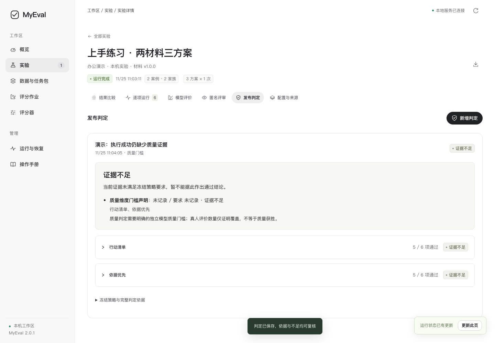
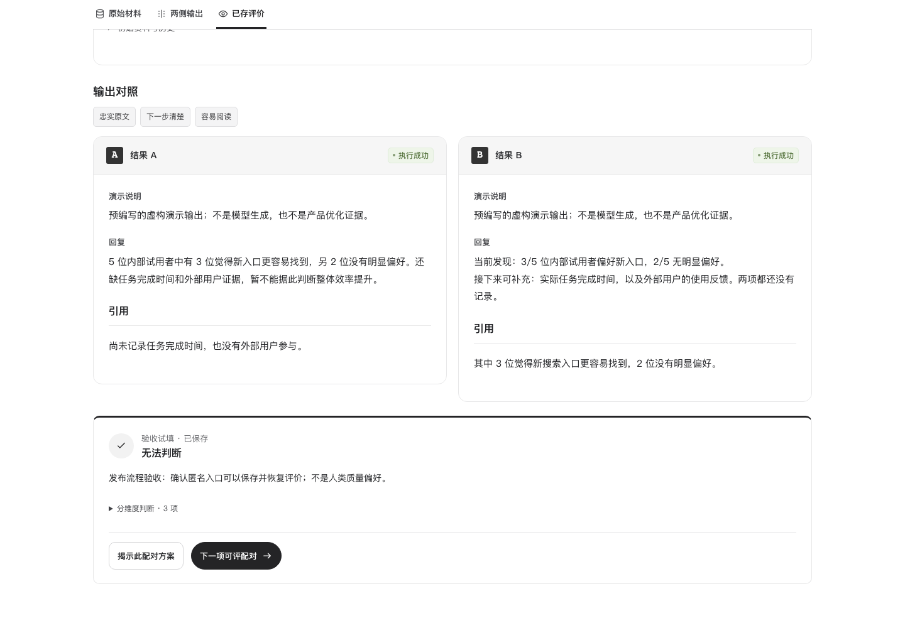
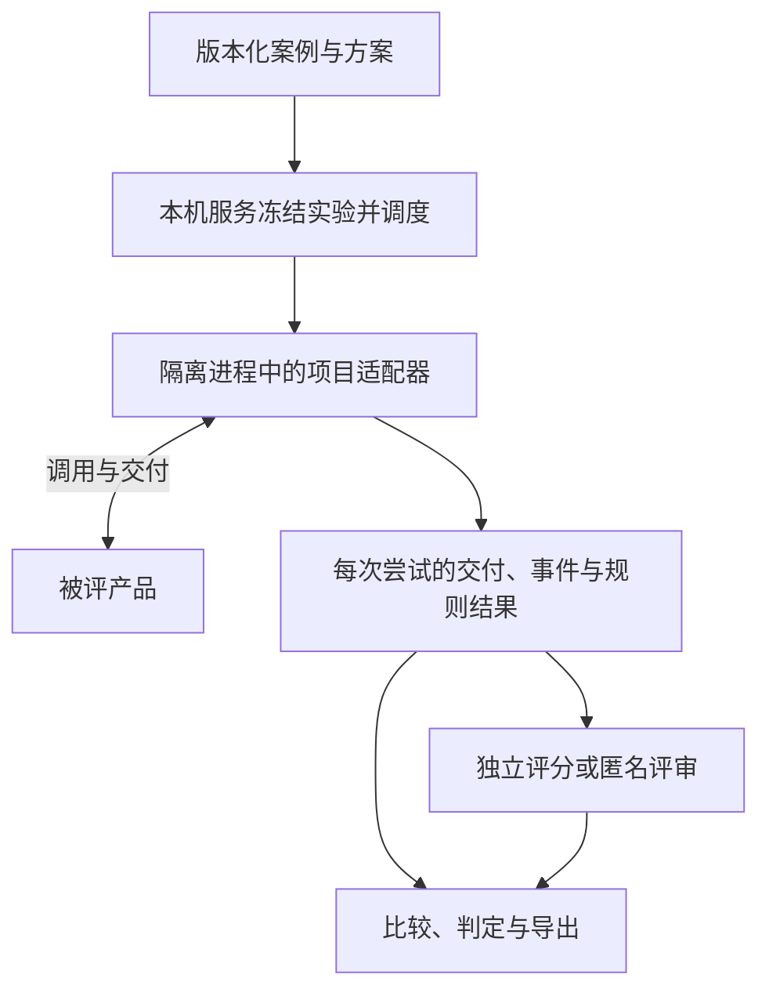

# MyEval

MyEval 是一套在本机运行的开源 AI 助手（Agent）评测平台。改了提示词、模型参数或多轮对话策略后，你可以把同一批材料交给当前方案（基线）和候选方案，通过产品自己的入口执行，再逐例读它们实际交付的内容。决定是否采用候选时，可以分别核对回复质量、失败原因、模型用量，以及评审者为什么偏好其中一份。

[图文操作手册](docs/playbooks/README.md) · [三个真实项目的评测案例](docs/playbooks/real-projects.md) · [能力与边界](docs/capabilities.md)

## 快速开始

准备 Git、Python 3.11 或更高版本和浏览器。核心使用 Python 标准库和 SQLite，前端无需构建。执行器依赖 POSIX 文件锁和进程组。本版在 macOS、Python 3.14.3 上实测，Linux / WSL 尚未完成运行验收，原生 Windows 暂不支持。

```sh
git clone https://github.com/ZB-ur/MyEval.git
cd MyEval
python3 scripts/demo.py --port 8330
```

浏览器会打开本机工作台。首次启动会建立 **办公回复 · 三方案演示**，让「原文摘要」「行动清单」「依据优先」三个方案各处理 6 个虚构办公案例。演示的回复已预先写好，无需业务项目、模型或 API 密钥。排队、执行、存储和评审都走平台的正常流程。

**首次运行应看到 18 项运行、15 项成功、3 项异常。** 三个异常来自同一个故障演练，三个方案都收到了总结附件的请求，材料却没有附上文件。在「异常实验」里可以追到每一项失败的阶段记录。


按 Ctrl+C 停止服务，实验和评价保存在 `.local/demo/`。再次执行启动命令可继续查看。浏览器若未自动打开，在另一个终端运行 `scripts/open --data-dir .local/demo`。[手机宽度的工作台](docs/assets/workbench-mobile.png)

## 做一轮比较

1. 在 **新建实验 → 选择材料** 里选「办公演示」项目，只勾选「会议安排」和「上线计划」。任务包把带版本的案例、允许使用的方案以及预期行为放在一起。
2. 在 **比较方案** 中以「原文摘要」为基线，勾选「行动清单」和「依据优先」两个候选。每个候选单独和基线对照，一个实验可选 1 至 15 个候选。
3. 在 **执行设置** 填实验名称，重复次数留为 1，勾选 **先建立实验，暂不开始调度**。到 **核对建立** 确认 **2 个案例 × 3 个方案 × 1 次 = 6 项运行**。点 **建立并暂停**，再在实验详情点 **恢复调度**。平台在建立时固定材料、配置和相关源码的内容指纹（哈希），执行前发现来源已变会要求另建实验。[查看建立前的核对画面](docs/assets/playbook/create-review.png)
4. 点 **结果比较 → 逐例对照输出**，选「会议安排」和候选「行动清单」。找找两侧各自怎样交代周三的议题提交期限、周四的开会时间和待定的会议室。点 **原图与输入** 可直接核对原通知。


跟随图文演练可继续追踪失败、保存匿名评价、导出并恢复工作区。[完整上手 Playbook](docs/walkthrough.md) · [离线录像与 23 个关键帧](https://github.com/ZB-ur/MyEval/releases/download/v2.0.1/MyEval-v2.0.1-playbook.zip)

## 怎样读结果、做决定

预置演示的三个方案都成功交付了 6 例中的 5 例。83.3% 回答的是执行成功率。要决定哪份回复更适合发给同事，还需要看交付原文和评价依据。演示里的模型评价和人工判断均从 0 开始，耗时来自本机脚本。[查看演示的比较页](docs/assets/comparison-desktop.png)

| 你要判断什么 | 应看哪些证据 |
| --- | --- |
| 是哪次运行出了问题？ | 一项运行（trial）固定一个案例、一个方案和一个重复序号。重试在原运行里增加一次尝试（attempt）。从 **逐项运行 → 阶段与尝试** 可查找首轮失败、超时、取消、拒绝或不支持的原因，以及后续尝试。已有匿名评价的配对要另建实验才能重跑。 |
| 交付的内容好在哪里？ | 规则能检查一段引文是否出现在原文里。独立 AI 评分器按量表（判断维度和标准）评价具体输出，保留理由与引文。**匿名评审** 让人对随机排列的 A/B 两侧选一侧、平局或无法判断。已看过方案身份的操作演练选 **验收试填**，会单独计数。 |
| 候选的改善有多确定？ | 先看有多少案例能配对、缺失了哪些。来自同一原始情境的案例归入一个「家族」，例如同一张照片配两种提问。重复与变式先在家族内合并，各家族等权。再看候选减基线的分差及其 95% 区间。如果区间跨过 0，改善方向仍不确定。 |
| 别人如何复核？ | 点 **导出证据** 下载管理员 ZIP，先清除案例筛选可导出整组。`manifest.json` 汇总实验，`trials.jsonl` 列出运行和尝试，`evidence/` 保存可用的逐次证据。匿名席位可单独导出隐藏方案映射的 JSON。 |

两案例练习的 **6 项运行全部成功**，独立模型评价和人工判断都是 0。要复现下图，在 **发布判定 → 新增判定** 选「质量判定」，把最少独立情境家族从 5 改为 **2**。执行成功率和完成率均设为 100%，真人评价配对设为 0，留出和规则覆盖均不作要求，质量维度暂不设置。点 **运行并保存判定**，两个候选的结果都是 **证据不足**。展开任一候选可查看缺少哪项依据。[核对手册第 7 节的判定设置](docs/walkthrough.md#7-保存一个诚实的判定) · [查看这 6 项运行的完成页](docs/assets/playbook/create-completed.png)



<details>
<summary>展开匿名 A/B 评审截图</summary>



</details>

## 三个项目怎样用 MyEval

这些结论来自 2026 年 11 月通过产品入口执行的实验。仓库提供方法、适配器、任务包和已发布的汇总结果。原始产品输出和私有数据库保存在原评测工作区，运行真实产品所需的环境由使用者准备。

| 项目与评测问题 | 那次比较得到的结论 |
| --- | --- |
| **思间 Sijian** 比较笔记发现与复盘策略。精简回复后，能否仍然根据原文推进思考？ | 两个独立 AI 评分器在预先指定的目标上都支持精简候选。逐例复核仍发现对原文含义的额外推断，真人满意度需要另测。[思间适配条件](docs/adapter-sijian.md) |
| **日记本 pome** 让各方案沿用自己交付的回复，完成文字对话、整理与保存。缩短参考材料后，交流质量能否维持？ | 紧凑候选的模型文本用量（token）比基线少 **28.37%**，当轮质量证据不足以确认它至少与基线持平，产品继续沿用基线。[pome 适配条件](docs/adapter-pome.md) |
| **Sidelit** 用公开许可照片和拍摄意图评测 Mac 上的原生视觉模型。去掉强制打分后，点评能否更有用、更少虚构？ | 后续开发轮次完成 **36 项**运行。两个候选都出现了严重虚构，均未达到进入确认集的条件。物理 iPhone 上的模型、相机和能耗仍待另测。[Sidelit 适配条件](docs/adapter-sidelit.md) |

案例手册按材料、基线、执行、评阅和决策拆解这三轮工作，可与当时冻结的比较条件一起阅读。[真实项目 Playbook](docs/playbooks/real-projects.md) · [实验协议](docs/experiment-protocol-v2.md) · [历史验收](docs/acceptance/2026-11-18-platform-v2.md)

## 能力与边界

- **随仓库可用。** 本机工作台支持版本化材料、多方案队列、逐次证据、匿名评审、JSON/ZIP 导出，以及在新的数据目录恢复备份。可导入已完成的历史轨迹，保留原失败与来源。
- **需要相应环境。** 真实产品执行需要本机适配器和产品入口。思间使用已登录的 Codex CLI，pome 需要获授权的 DeepSeek 配置，Sidelit 需要匹配的原生构建、模型权重和图片。独立模型评分和指定历史尝试的重评需要可用的评分器。轨迹也可选择同步到本机 Langfuse。[评分与重评](docs/evaluation-v2.md) · [可选观测服务](docs/platform.md)
- **当前未覆盖。** 分布式执行、多租户与企业权限、生产流量在线 A/B、任意网站或手机 App 的无人值守端到端评测。真实用户偏好和真机性能需要相应用户与设备的独立验证。[完整能力矩阵](docs/capabilities.md)

## 接入自己的 Agent

在仓库根目录运行 `scripts/run.sh` 启动正式工作区，再在另一个终端运行 `scripts/open` 打开管理员页面。默认服务监听 `127.0.0.1:8310`，数据库和运行文件保存在 `.local/data/`。这两条命令使用同一个 `--data-dir` 即可切换工作区。

**程序接口。** 平台提供本机 HTTP JSON API 和命令行 `scripts/eval`。Python 扩展契约随源码分发，目前没有单独发布的 SDK 包。保持演示服务运行，在另一个终端导入两份虚构材料，运行三个方案并等待完成。返回的实验 ID 可用于 `show`、`analysis` 或 `export`。[HTTP 与 CLI 参考](docs/api-v2.md) · [完整 CLI 示例与预期结果](examples/README.md)

```sh
scripts/eval --data-dir .local/demo datasets import examples/office-dataset.json
scripts/eval --data-dir .local/demo start examples/office-comparison.json --wait
```

**扩展执行。** 在 `myeval/adapters/` 用 `describe(configuration)` 声明能力、来源与限制，用 `run(case, configuration, ctx)` 调用产品的 HTTP 接口、命令行程序或共享模块。配套任务包登记输入、基线和候选，量表描述评阅标准。可直接对照仓库内的可运行样例。[演示适配器](myeval/adapters/demo.py) · [配套任务包](taskpacks/demo.json) · [适配契约](docs/adapter-contract.md)

<details>
<summary>查看适配器、执行证据与评阅的关系</summary>



</details>

**数据与费用。** 本机保存执行证据。使用远端产品模型或独立评分器时，相应材料会按配置发送给提供方，并可能产生费用。私有材料需要相应授权。供应方未回报的生效参数、用量和费用显示为未知。预算按已观测用量限制后续调度，在途请求仍可能产生开销。导出管理员包前请核对其中的材料、交付与方案身份。

## 文档、求助与贡献

- 从头走一遍，或从已有产品找到相似的任务。[操作手册目录](docs/playbooks/README.md) · [工作原理](docs/architecture-v2.md)
- 核对本版的实际操作、CLI 示例与备份恢复，按版本追溯更新。[V2.0.1 操作验收](docs/acceptance/2026-11-25-open-source.md) · [V2.0.0 集成验收](docs/acceptance/2026-11-25-release.md) · [版本记录](CHANGELOG.md)
- 遇到使用问题或缺陷，附上版本、复现步骤和使用虚构材料的示例。安全问题请按专门渠道报告。[GitHub Issues](https://github.com/ZB-ur/MyEval/issues) · [安全报告](SECURITY.md)
- 贡献适配器或任务包时，说明调用的产品入口、需要的依赖，以及怎样复核实际运行结果。[贡献指南](CONTRIBUTING.md) · [Pull Request 模板](.github/pull_request_template.md)

## 许可证

MyEval 项目源码采用 MIT 许可证。第三方组件、外部产品及评测材料各自适用其原有许可。[MIT 许可证](LICENSE) · [第三方声明](THIRD_PARTY_NOTICES.md)
