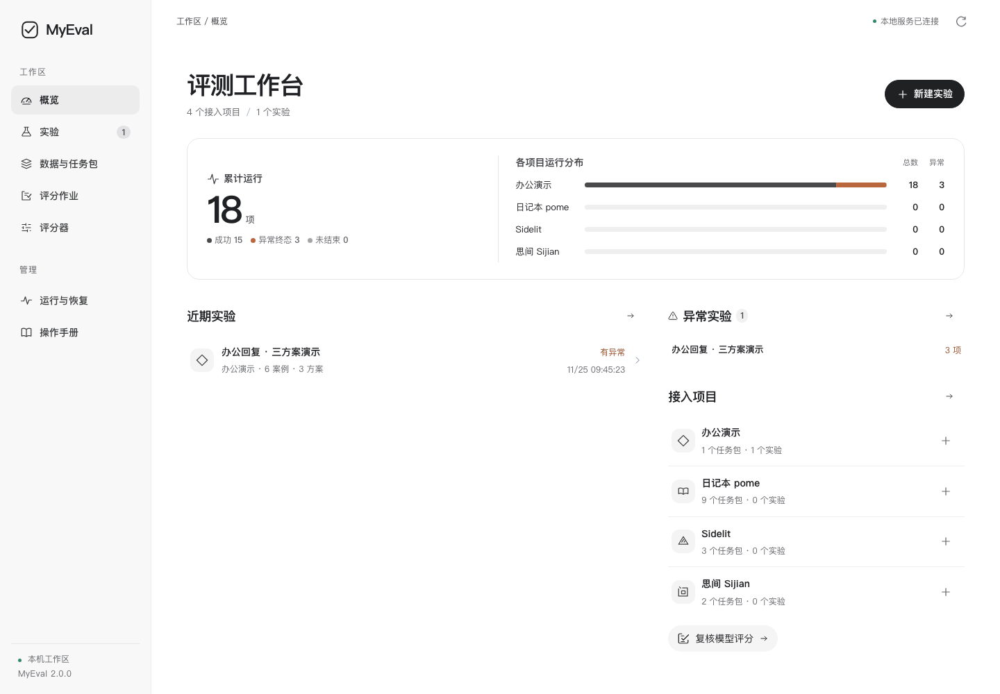
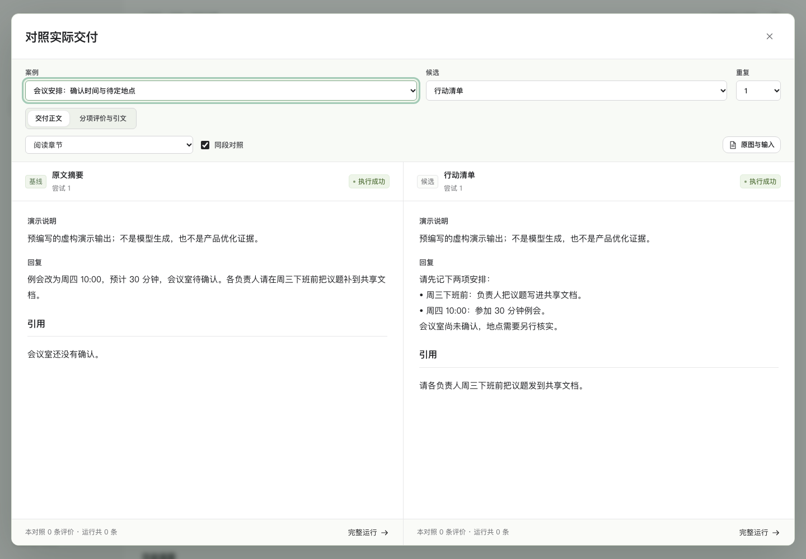

# MyEval

MyEval 是一个本机 Agent 评测工作台。改了提示词、模型参数或多轮对话策略后，你可以让当前方案和候选方案处理同一组材料，逐例对照它们交付的内容。发现差异时，可以回到当次输入、执行过程和评阅理由，判断这次改动值不值得采用。

## 快速开始

运行环境需要支持 POSIX，例如 macOS 或 Linux / WSL；原生 Windows 暂不支持。准备 Python 3.11 或更高版本和一个浏览器，在克隆或解压后的仓库根目录启动演示。以下步骤已在 macOS 和 Python 3.14.3 上实测，Linux / WSL 尚未完成运行验收。

```sh
python3 scripts/demo.py --port 8330
```

浏览器会自动打开本机工作台。首次启动会运行 **办公回复 · 三方案演示**，用 6 个虚构办公案例比较「原文摘要」「行动清单」「依据优先」三种回复方式。回复已随任务包写好，工作台在本机排队执行并保存结果，演示全程无需模型、API 密钥或业务项目。核心只用 Python 标准库和 SQLite，前端无需构建。

首页应显示 **18 项运行，15 项成功，3 项异常**。点「近期实验」中的演示可阅读三种回复。点「异常实验」中的记录，可看到「附件未提供」这个案例在三个方案下都按设计失败。按 Ctrl+C 停止服务，实验和评价保存在 `.local/demo/`。浏览器若未自动打开，在第二个终端运行 `scripts/open --data-dir .local/demo`。



[手机尺寸的工作台](docs/assets/workbench-mobile.png) · [图文操作指南](docs/walkthrough.md)

## 做一轮多方案比较

1. 点 **新建实验**。在 **选择材料** 中选「办公演示」项目及其任务包，只勾选「会议安排」和「上线计划」两个案例。任务包提供带版本的输入和可选方案。
2. 在 **比较方案** 中以「原文摘要」为基线，勾选「行动清单」和「依据优先」两个候选。基线是本次比较的参照，所有候选分别与它配对。一个实验可选 1 至 15 个候选。
3. 在 **执行设置** 填写实验名称，重复次数留为 1。到 **核对建立** 应看到 **2 个案例 × 3 个方案 × 1 次 = 6 项运行**，点 **建立并启动**。
4. 在 **结果比较 → 逐例对照输出** 中选「会议安排」，候选选「行动清单」。对照两侧回复，看看各自怎样交代开会时间、提交议题的期限和仍待确认的会议室。点 **原图与输入** 可核对原通知。



## 从结论回到证据

在预置演示中，每个方案都成功交付了 6 例中的 5 例，耗时来自本机脚本，模型评价和人工判断均为 0。要判断哪份回复更适合发给同事，可以打开原文复核，也可以请评审者在隐藏方案身份的情况下选择。[查看演示的结果比较页](docs/assets/comparison-desktop.png)

| 想弄清的问题 | 在哪里看 |
| --- | --- |
| 哪个版本跑出了这个结果？ | **配置与来源** 显示建立实验时固定的材料、方案和源码指纹（内容哈希）。执行前会再次核对来源，源码已变时需另建实验。请求参数和实际回报值分别记录，未观测到的参数、用量或费用保留为未知。 |
| 失败后重试，样本数怎么算？ | 一项运行（trial）对应一个案例、一个方案、一个重复序号。重试会在原运行里追加一次尝试（attempt）。在 **逐项运行 → 阶段与尝试** 能看到首轮失败和重试结果。已被匿名评阅的配对要另建实验才能重跑。 |
| 三个方案成功率相同，质量也相同吗？ | 成功率统计交付完成情况。演示的规则会检查回复所引的句子能否在原文中找到。真实评测可在 **模型评价** 中用另行配置的独立评分器按量表评判，每条评分关联具体尝试和输出，可回看引文。 |
| 人更喜欢哪份交付？ | 在 **匿名评审** 打开独立席位。方案随机分到 A、B 两侧，评审者可选一侧、平局或无法判断，并写下理由。已看过方案身份的演练选 **验收试填**，会单独计数。 |
| 有多少种独立情形支持这个判断？ | 比较时先合并同一案例的重复，再给每个情境家族相同权重。例如，同一张照片配两种提问仍是一个家族。看候选与基线的质量差异时，一起读有效配对数、家族数和 95% 区间。 |
| 怎样导出供别人复核？ | 点实验右上角的 **导出证据** 下载带方案身份的 ZIP，先清除案例筛选可导出整组。`manifest.json` 汇总实验，`trials.jsonl` 列出运行，`evidence/` 保存可用的逐次证据。匿名评审者可从自己的席位导出匿名版本。[HTTP 与 CLI](docs/api-v2.md) |

需要记录是否采用候选时，可在 **发布判定** 保存检查条件和依据。即使所有运行都已成功，缺少所需质量证据时，判定也会显示「证据不足」。

<details>
<summary>展开匿名 A/B 评审截图</summary>


</details>

## 接入真实 Agent

要开始自己的工作区，在仓库根目录运行 `scripts/run.sh`，再开一个终端运行 `scripts/open` 进入管理员页面。两者默认使用同一个本机数据目录 `.local/data/`，服务监听 `127.0.0.1:8310`。使用 `--data-dir` 时给两条命令传入同一路径。

适配器在独立工作区调用产品已有的 HTTP 接口、命令行程序或共享业务模块，带回实际交付和可观察的事件。下列产品适配器随仓库提供，产品源码、模型环境和授权由使用者准备。业务模型及独立评分器可按配置发起外部请求。

| 产品与执行路径 | 本机需要准备 |
| --- | --- |
| **思间 Sijian** 通过 `/discover` 做文字发现，通过 `/review` 做复盘。 | 带评测接口的思间源码，以及已登录的 Codex CLI。[思间适配说明](docs/adapter-sijian.md) |
| **日记本 pome** 完成文字多轮对话、日记整理与保存。每个方案沿用自己此前交付的回复。 | 带对应策略和观测接口的 pomegranagent-v2 源码，以及已授权的 DeepSeek 本机配置。[pome 适配说明](docs/adapter-pome.md) |
| **Sidelit** 在 Mac 上经共享 Swift/C++ 视觉运行时处理图片，取得模型原文及解析结果。 | 匹配协议的原生构建、模型权重和有来源的图片。[Sidelit 适配说明](docs/adapter-sidelit.md) |

接入自己的 Agent 时，在 `myeval/adapters/` 中实现两个函数。用 `describe(configuration)` 声明能力与来源，用 `run(case, configuration, ctx)` 调用业务入口并返回结果。再把案例、预期行为和配置写进同项目的任务包。最小可运行示例随演示提供。[演示适配器](myeval/adapters/demo.py) · [配套任务包](taskpacks/demo.json) · [适配契约](docs/adapter-contract.md) · [评分量表](rubrics/)

## 适用范围

2026 年 11 月的本机验收覆盖三个产品的实际执行、匿名试填、证据导出和恢复。思间的原生文字旅程在模拟器上验证，pome 的语音旅程使用合成输入，Sidelit 的模型推理在 Mac 上验证。真实用户偏好、专家一致性、真机性能与听感仍需独立证据。[三项目历史验收](docs/acceptance/2026-11-18-platform-v2.md)

当前工作台面向单机实验，执行器依赖 POSIX 进程组与文件锁。企业权限、多租户、分布式执行和线上 A/B 尚未覆盖。[当前状态](docs/status.md) · [本版验收](docs/acceptance/2026-11-25-release.md) · [工作原理与能力范围](docs/architecture-v2.md) · [独立评分与历史重评](docs/evaluation-v2.md)

[参与开发](CONTRIBUTING.md) · [第三方组件声明](THIRD_PARTY_NOTICES.md)
