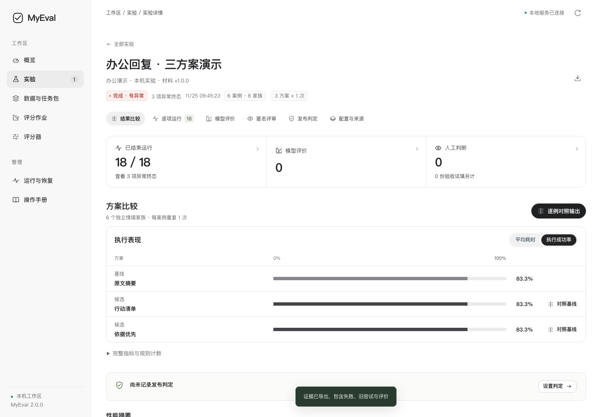
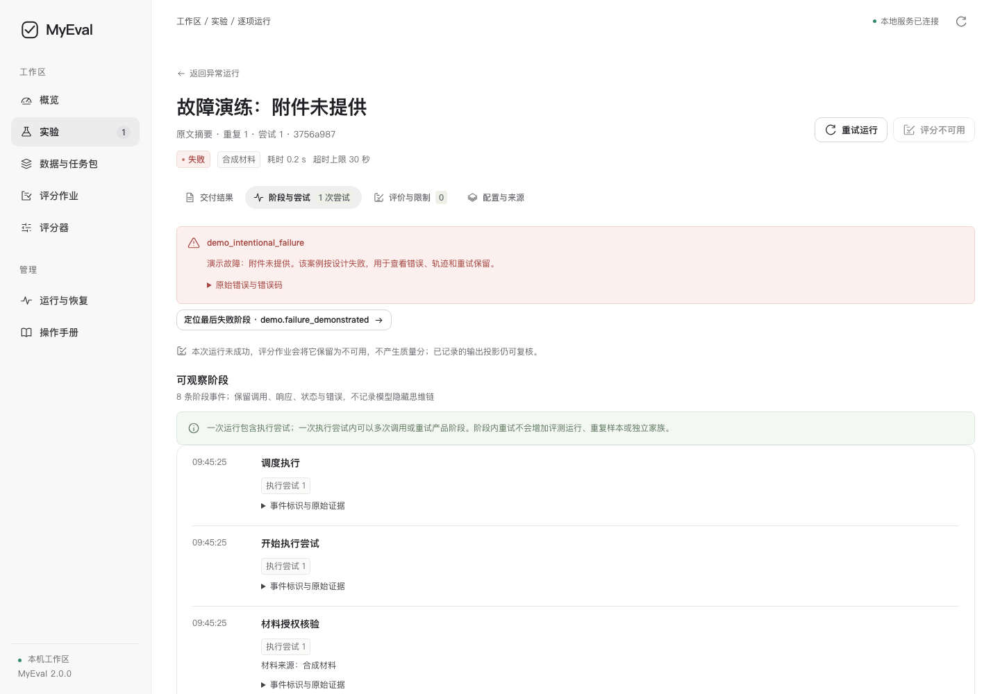
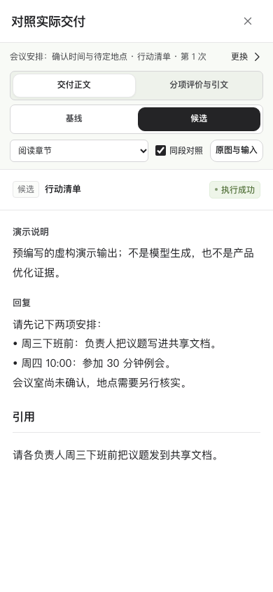

# 跟着演示完成一次比较

以下截图来自 V2.0.0 的真实界面与随仓库提供的虚构办公材料。三个方案的回复是预编写示例，没有模型调用；成功率与耗时展示执行事实，不说明 AI 质量。

## 1. 启动并找到实验

在仓库根目录运行：

```sh
python3 scripts/demo.py --port 8330
```

脚本使用独立 `.local/demo/`，自动打开已认证的浏览器。首次运行建立“办公回复 · 三方案演示”：6 个案例 × 3 个方案，共 18 项运行。其中 15 成功、3 个“附件未提供”故障演练，所有故障都会留下记录。


页面中的 Sijian、pome 和 Sidelit 是已登记的适配器。演示不启动它们，也不需要这些产品已安装。

## 2. 先看执行，再读交付

点击“办公回复 · 三方案演示”，可以切换平均耗时和执行成功率。三个方案同为 5/6 成功，故障保留在分母中；模型评价为 0，用量保持“未知”。



点击“行动清单”或“依据优先”旁的“对照基线”，在同一案例下阅读两种回复。可切换案例、候选与重复序号，再打开原始输入核对引用。阅读正文比只看一个总分更能说明差异。


## 3. 追踪一次失败

返回实验页，点击“查看 3 项异常终态”。选中故障案例与失败状态，再进入“查阶段证据”，可以看到材料核验、来源哈希核验、故障事件和终态写入。返回异常运行后，案例与状态筛选仍然保留。



重试会在原运行中追加 attempt（执行尝试），不会抹掉旧错误，也不会增加独立样本。来源改变时会阻止继续执行，需要建立新的实验。

## 4. 用独立席位阅读 A/B

在实验的“匿名评审”页打开独立评审席位。评审者看到材料与结果 A/B，不看到配置名称；需要更多评审者时创建新的席位。

如果只是验证操作，请将“评价用途”选为“验收试填”。本次指南保存了“无法判断”，刷新后仍显示已存记录；这条记录不计入真实人工偏好。


## 5. 导出并保留工作

点击实验右上角的下载图标，得到 ZIP。它包含案例、配置、18 项运行、每次执行尝试、事件与失败。本次浏览器下载的归档含 69 个文件，CRC 检查通过。后续若新增评价或重试，新的导出内容会相应增加。

在终端按 **Ctrl+C** 停止演示，再执行同一启动命令，会保留原实验与评价，不重新建立或自动重试。换一个演示工作区时使用 `--data-dir .local/demo-another`；脚本拒绝使用已有的非演示目录。

## 手机上怎么看

390px 宽度下，导航变为抽屉，比较正文使用“基线／候选”切换。正文与引用保留完整内容。以下是 Chromium 触控视口的真实截图，不代表物理手机验收。

<p>
  
  
</p>

## 录像与进一步操作

本次连续操作录制为三段已关闭原片，按桌面、匿名评审、手机宽度组织。本机完整播放器、关键帧和来源哈希位于 `.local/delivery/20261125/playbook/playbook.html`；原片未随 GitHub 分发。录制只覆盖这些操作窗口，不包含后台开发过程。

要制作自己的录屏手册，见[生成方法](recording-playbook.md)。要接入真实 Agent，见[适配契约](adapter-contract.md)；要操作数据、评分队列与备份，见 [HTTP / CLI](api-v2.md)。
