# 完成一次有证据的方案比较

这份 playbook 从启动一直走到恢复备份。先用演示认识界面，再亲手建立一轮比较；真实项目如何选材料、运行候选和决定是否采用，见 [Sijian / pome / Sidelit 案例](playbooks/real-projects.md)。

**演示材料：** 6 个原创虚构办公案例、3 种预编写回复。它通过真实队列、worker、数据库和浏览器运行，但 **不调用模型**，不证明任何 AI 的质量。截图来自 2.0.0–2.0.1 实际界面；后续新增实验或评价后，计数会变化。

[启动](#1-启动独立演示) · [比较](#2-比较同一材料的实际交付) · [失败](#3-追踪失败并理解重试) · [新建实验](#4-亲手建立一轮比较) · [独立评分](#5-配置独立评分) · [匿名评审](#6-用独立席位阅读-ab) · [判定](#7-保存一个诚实的判定) · [导出](#8-导出并保留完整证据) · [数据集与 CLI](#9-版本化材料与-cli) · [恢复](#10-备份恢复并重新打开)

## 1. 启动独立演示

准备 Git 与 **Python 3.11+**。实际验收环境为 macOS / Python 3.14.3；本机锁和进程管理依赖 POSIX，原生 Windows 不支持，Linux/WSL 未完成运行验收。核心只用 Python 标准库，没有 npm 安装或前端构建步骤。

```sh
git clone https://github.com/ZB-ur/MyEval.git
cd MyEval
python3 scripts/demo.py --port 8330
```

保持这个终端运行。脚本建立独立 `.local/demo/`，自动打开已认证的浏览器。若浏览器未打开，在另一个终端运行：

```sh
scripts/open --data-dir .local/demo
```

首页应出现“办公回复 · 三方案演示”：**18 项运行，15 成功，3 个“附件未提供”故障演练**。故障是专门安排的，不需要修改代码消除。若仍显示运行中，点击右上角刷新。

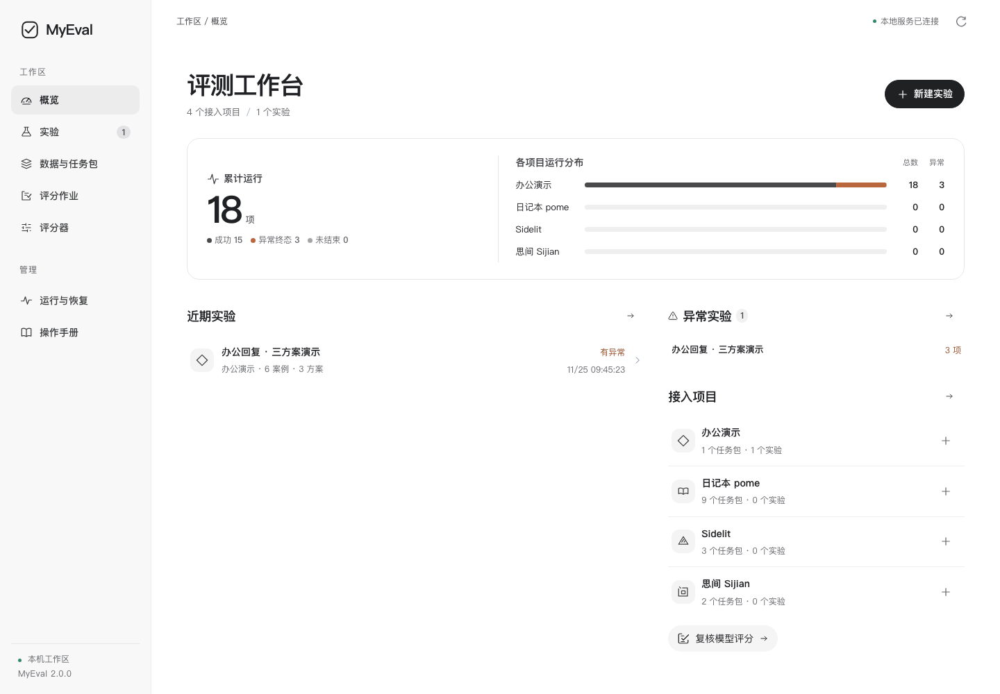

Sijian、pome 和 Sidelit 是已登记的适配器。演示不启动它们，也不需要安装对应产品。管理员访问码保存在数据目录中；分享步骤时不要分享管理员入口或完整匿名访问链接。

## 2. 比较同一材料的实际交付

点击“办公回复 · 三方案演示”，切换“平均耗时／执行成功率”。三个方案同为 **5/6 成功**，故障保留在分母里。模型评价为 0，用量保持未知；预编写回复的耗时不能解释成模型推理性能。


点击“行动清单”或“依据优先”旁的“对照基线”。两侧对应同一案例和重复序号；切换案例、候选或打开“原图与输入”，核对交付是否保留材料中的限制。

例如会议案例里，会议时间已确定，会议室未确定。可以比较哪种呈现更易读，但不能把更长、分点更多或引用更多直接当作质量更高。

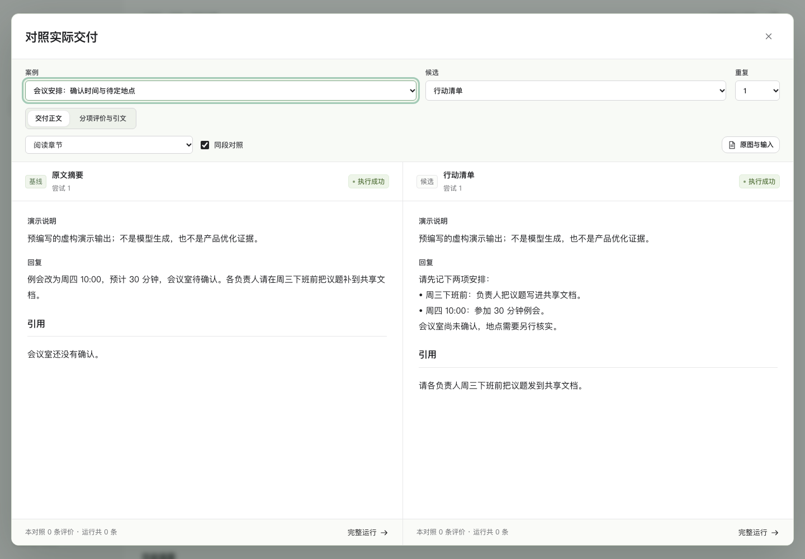

## 3. 追踪失败并理解重试

返回实验页，点击“查看 3 项异常终态”，将案例选为“故障演练：附件未提供”、状态选为“失败”，再点“查阶段证据”。可以看到材料核验、来源核验、故障事件与终态；返回后筛选仍保留。


这个案例故意没有附件。重试仍会失败，平台会追加新的 **attempt（执行尝试）**，保留旧错误；不会增加案例、独立家族或运行项。只熟悉操作时无需重试。

真实项目若显示 `source_changed_since_freeze`，表示当前来源不再匹配实验冻结值，该项在产品请求前被阻止。保留旧实验，按新来源另建实验，不覆盖原失败。

## 4. 亲手建立一轮比较

回到首页，点击“新建实验”。这次只选择两个无故障案例，完成一次小规模操作练习。

### 选择材料

项目选“办公演示”，材料来源选“已注册任务包”。点击“清空”，只勾选“会议安排”和“上线计划”。它们来自两个独立情境家族。

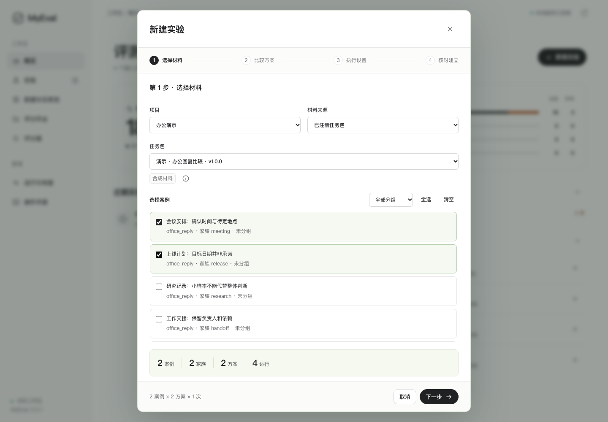

### 选择基线与候选

基线用“原文摘要”，勾选“行动清单”和“依据优先”。底部现在应为 **2 案例 × 3 方案 × 1 次 = 6 项运行**。

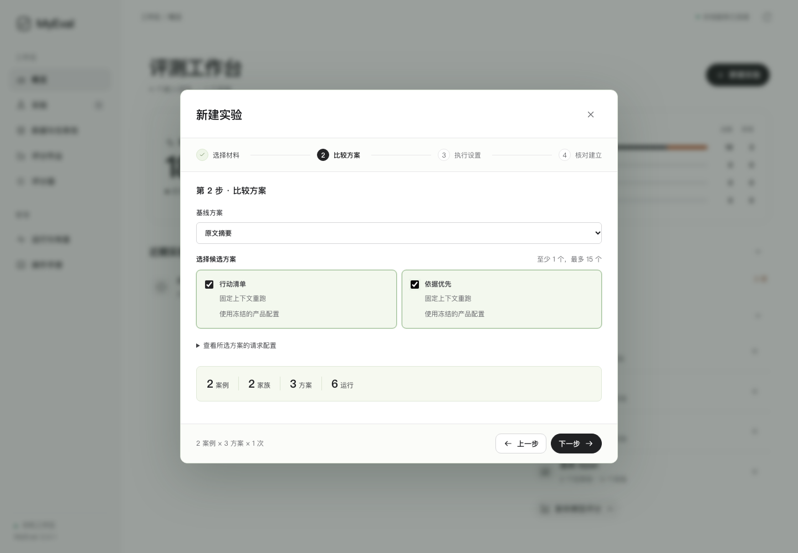

### 设置并核对

实验名称填“上手练习 · 两材料三方案”，重复 1 次、每项超时 30 秒、并发 1；勾选“先建立实验，暂不开始调度”。下一步核对材料、方案、来源与数量，再点“建立并暂停”。

<details>
<summary>查看执行设置截图</summary>

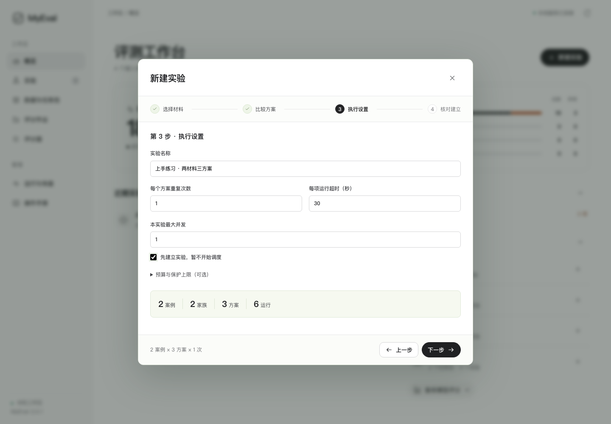

</details>

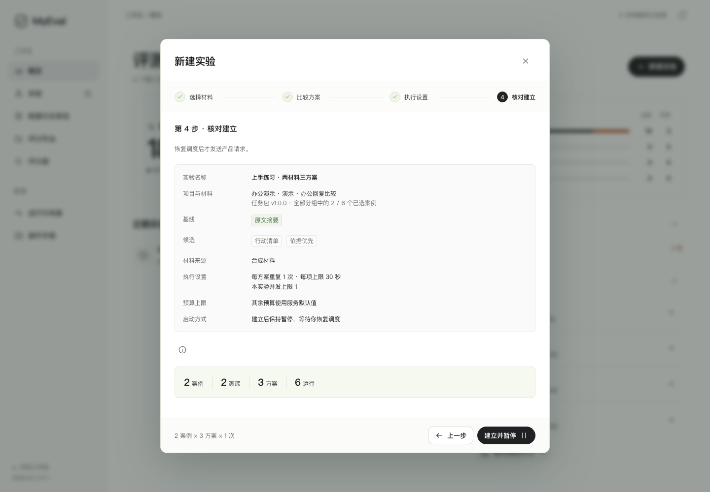

在实验页点击“恢复调度”，等队列执行后点击刷新。本次实际得到 **6/6 成功，0 模型评价，0 真实人工评价**。

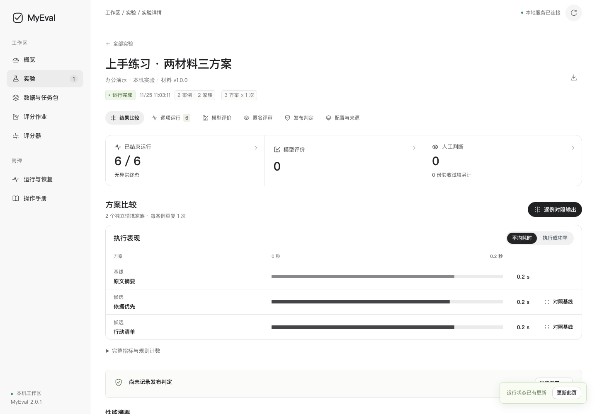

同一家族重复两次，不等于增加一个独立样本。详细术语和统计口径见[能力说明](capabilities.md#看清一次运行和一个独立样本)。

## 5. 配置独立评分

进入新实验的“模型评价”，点击“创建评分作业”。选择：

| 字段 | 本指南使用的值 | 对真实评测意味着什么 |
| --- | --- | --- |
| 评分器 | `codex-astra-v2` | 固定评分器版本；请求模型与实际生效值分开保存。 |
| 方式 | 基线与候选匿名配对 | 两材料 × 两候选，预检最多 4 个配对单元。 |
| 材料分组 | 全部分组 | 办公演示未声明独立留出，不能当泛化证据。 |
| 量表 | `general-v2` | 通用示例；真实业务应使用合适的项目或自定义量表。 |

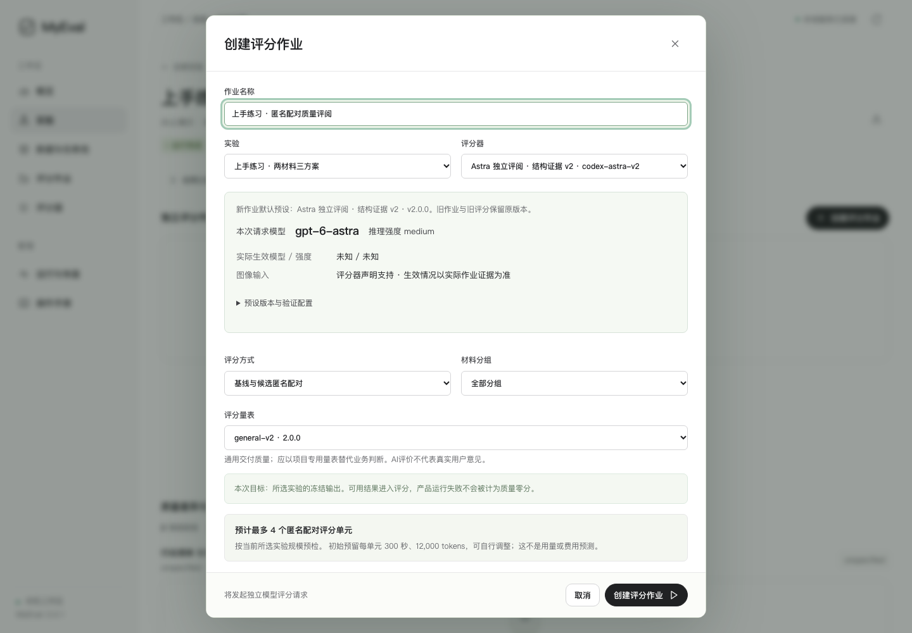

**演示到这里点“取消”，不提交。** 真正点击创建会调用独立模型，需要已登录且支持所需参数的 Codex CLI、可用模型及额度。截图只证明配置入口可用，没有生成评分，也没有把请求模型当成实际生效模型。

<details>
<summary>查看预算，以及真实作业创建后应检查什么</summary>

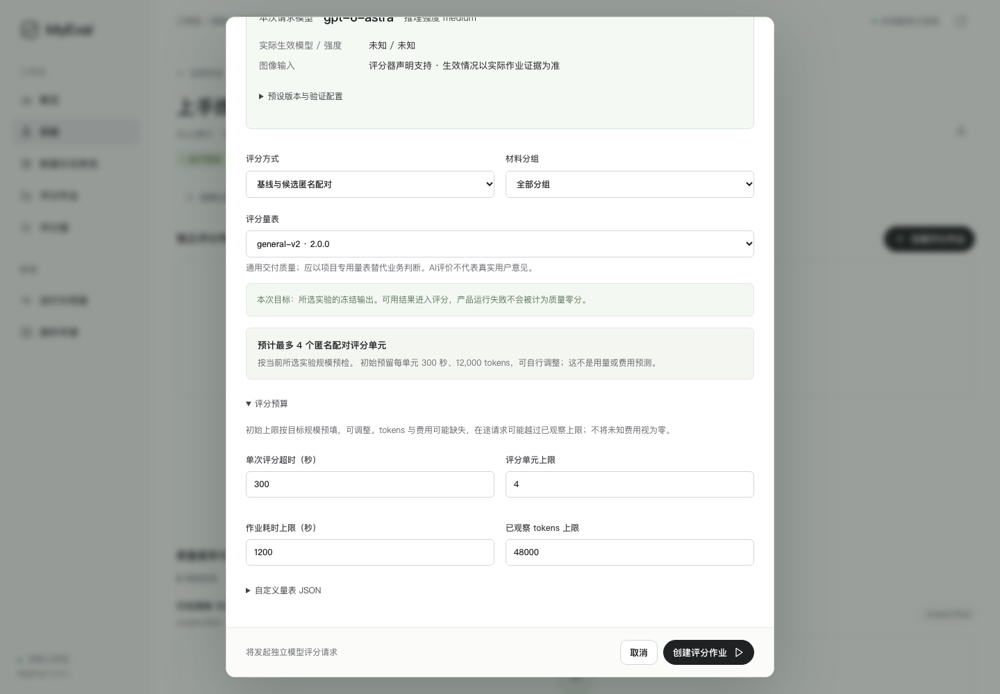

预算预填值不是费用预测；用量可能缺失，在途请求也可能越过已观察上限。真实运行后，逐项检查有效响应、引文、量表版本、不可用或失败单元，再读家族统计与覆盖率。产品执行失败不会被记为质量零分，也不会消失。

多位裁判分别建立作业、分别报告；裁判分歧回到原文或原图复核。更换量表或裁判可以重评已有输出，不必重跑产品。详细环境和请求格式见[独立评分](evaluation-v2.md)。

</details>

## 6. 用独立席位阅读 A/B

在“匿名评审”页打开独立评审席位。评审者看到材料和结果 A/B，不看到配置名称；增加评审者时建立新席位。管理员页面和管理员导出仍可见配置身份。

仅练习时，将“评价用途”选为“验收试填”，可选“无法判断”，写明这是操作练习后保存。刷新应看到已存记录；**验收试填单独计数，不计入真人偏好**。

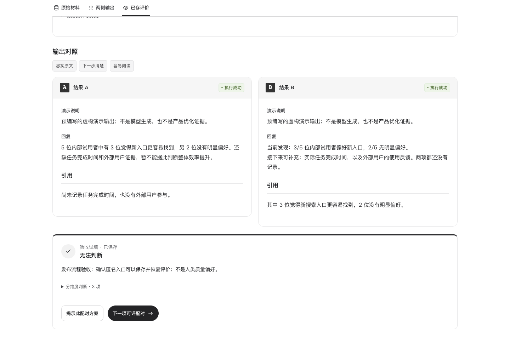

截图来自初始 18 项演示的已保存试填。相同操作也适用于新建的 6 项实验，但不是同一条评价记录。

## 7. 保存一个诚实的判定

回到“上手练习 · 两材料三方案”，进入“发布判定 → 新增判定”。为了只演示缺少质量评价的后果，使用：质量判定、最少家族 2、执行成功率和完成率均 100%、真人配对最少 0、不要求留出、不要求规则覆盖、暂不设置质量维度。名称填“演示：执行成功仍缺少质量证据”。

点击“运行并保存判定”。即使 6 项全部执行成功，实际结果仍是 **证据不足**。

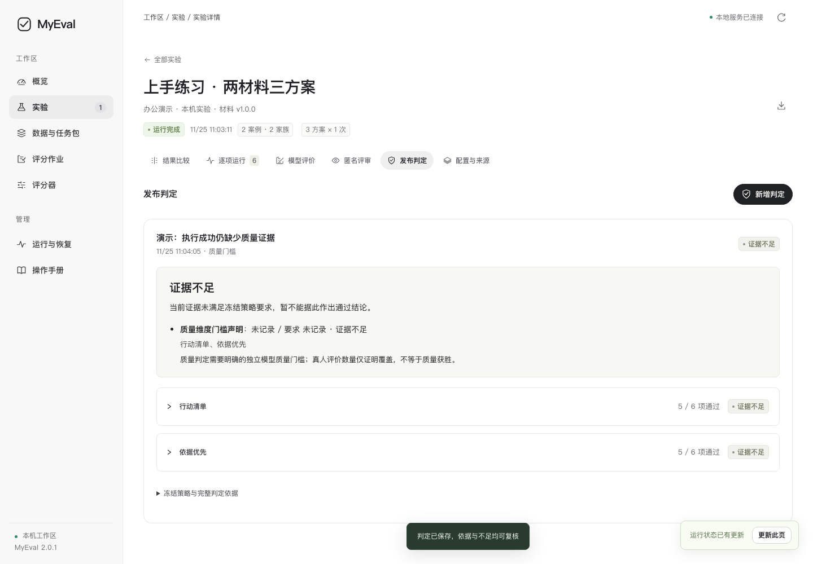

这组宽松门槛仅解释机制，不是业务发布标准。正式评测应预先约定独立材料、必需规则、明确版本的质量维度、有效家族与覆盖，以及所需的真实人工意见。证据变化会使旧判定不再对应当前结果；判定不会自动部署或切换产品默认。

## 8. 导出并保留完整证据

点击实验右上角下载图标，得到当前实验的 ZIP。**当前练习应导出 6 项运行**，以及其尝试、事件和已保存判定。初始“办公回复 · 三方案演示”的实测收据另为 18 项运行、18 次尝试、69 个文件，CRC 校验通过；这是另一份实验，不要用其文件数判断当前练习是否完整。新增试填、重试或判定后，文件数可能变化。

导出用于授权复核、历史导入或本地归档。它包含输入、实际输出和配置身份，**不是自动脱敏的公开数据包**。匿名阅读应使用对应席位和匿名导出。

导入旧轨迹时，平台保留原始身份和失败，不自动重放产品；原评分与判定作为历史来源保留，不冒充新实验当前评价。完整字段见 [HTTP / CLI](api-v2.md#数据集与历史回流)。

## 9. 版本化材料与 CLI

随仓库提供[两材料示例](../examples/README.md)：导入同一组原创办公材料的 `1.0.0` 数据集，再运行其冻结版本。保持演示服务运行，在第二个终端执行：

```sh
scripts/eval --data-dir .local/demo datasets import examples/office-dataset.json
scripts/eval --data-dir .local/demo start examples/office-comparison.json --wait
```

会得到另一个 **6 项运行全部成功**的实验。记录返回的实验 ID，再查询或导出。把下面 `YOUR_EXPERIMENT_ID` 换成实际 ID：

```sh
MYEVAL_EXPERIMENT_ID='YOUR_EXPERIMENT_ID'
scripts/eval --data-dir .local/demo experiments
scripts/eval --data-dir .local/demo show "$MYEVAL_EXPERIMENT_ID"
scripts/eval --data-dir .local/demo export "$MYEVAL_EXPERIMENT_ID" --output .local/office-evidence.zip
```

导出目标已存在时拒绝覆盖，换新文件名即可。自己的数据集应记录来源、版本、家族及开发/留出划分。同一来源的改写属于同一家族；已看过的留出材料不能重新标成未见。导入材料不会自动增加项目执行能力，配置仍须在适配器中注册。

## 10. 备份、恢复并重新打开

进入侧栏“运行与恢复”，等活跃运行与评分结束，点击“创建备份”。本次 2 个演示实验、24 项运行和 1 条判定的快照实际包含 121 个文件，清单与文件逐项校验通过。若也执行了 CLI 练习，数量会更多。

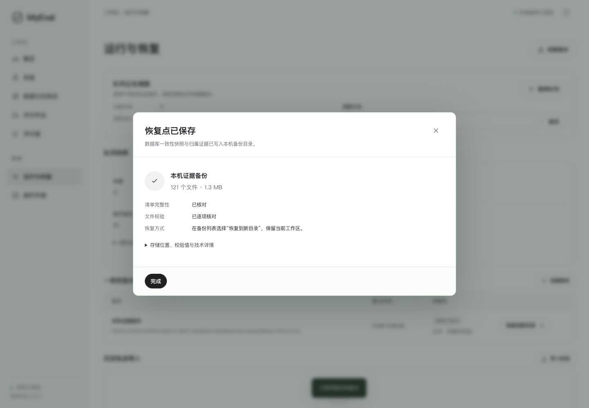

点“完成”，再点“恢复到新目录”，填写**不存在或为空的绝对路径**，点击“恢复副本”。不要使用当前工作区。截图中的临时路径是录制环境，读者使用自己的目录。

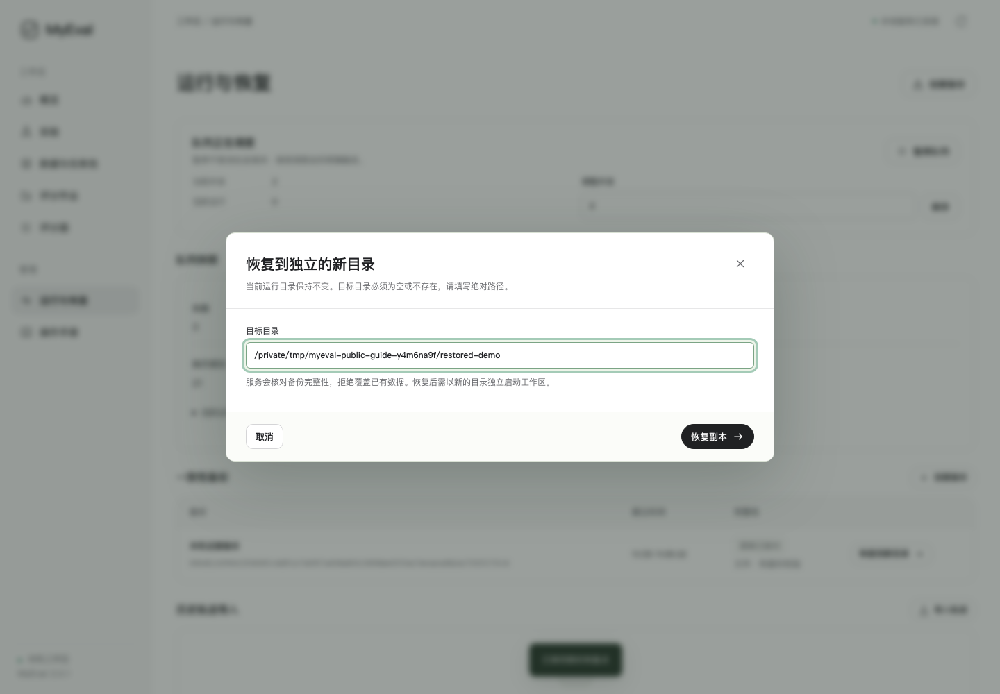

<details>
<summary>查看恢复后的收据</summary>

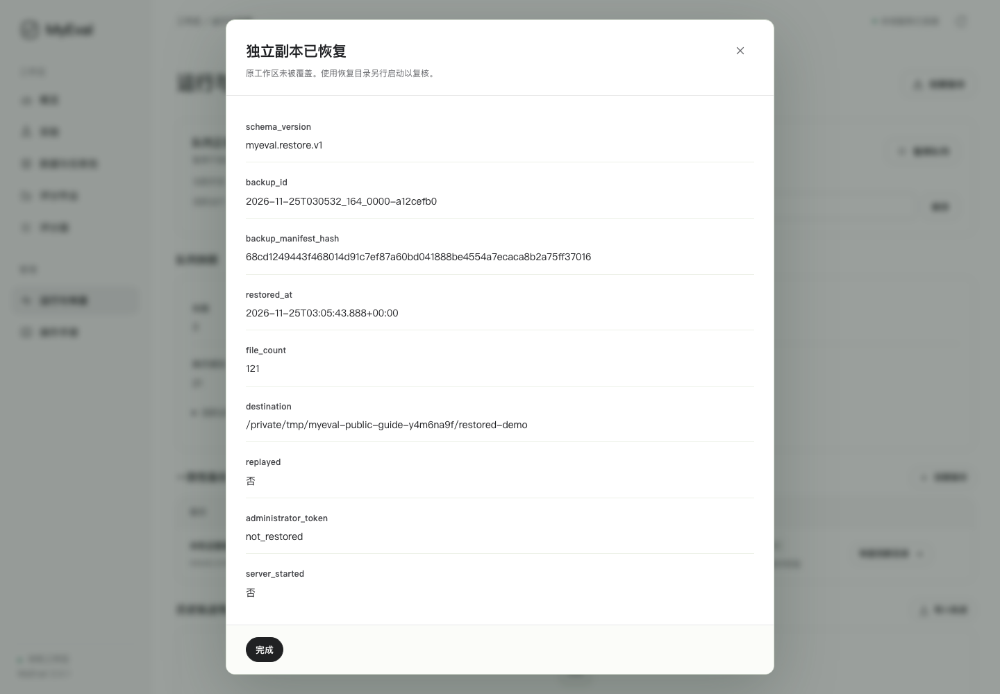

</details>

恢复只建立副本，不自动启动服务。在新终端用空闲端口启动副本，把路径替换为自己的恢复目录：

```sh
scripts/run.sh --port 8340 --data-dir /你的绝对路径/MyEval-restored
```

另开终端进入副本：

```sh
scripts/open --data-dir /你的绝对路径/MyEval-restored
```

本次实际启动后，2 个实验、24 项运行与“证据不足”判定仍在；管理员访问码与原码不同。备份不含完整产品环境、模型权重和提供者凭据，恢复证据不等于恢复外部产品环境。

## 手机上怎么看

390px 宽度下导航变为抽屉，比较正文使用“基线／候选”切换。以下是 Chromium 触控视口截图，不是物理手机验收。

<p>
  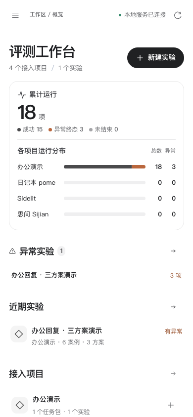
  
</p>

## 录像版与关键帧

[下载离线操作录像包](https://github.com/ZB-ur/MyEval/releases/download/v2.0.1/MyEval-v2.0.1-playbook.zip)，解压后打开 `playbook.html`。包含 **5 段实际录像、23 个章节与关键帧，共 5 分 1 秒**，可搜索章节、跳到对应画面并播放；无需启动 MyEval 或联网。

旧三段展示比较、失败与匿名评审；新增两段展示建实验、评分配置、判定和恢复。视频只用虚构办公演示；评分配置没有提交模型请求。片段之间有间隔，公开包保留原片哈希与录制范围，不声称录下全部开发过程。解压后保留 `media/` 和 `frames/` 的相对位置。

## 遇到问题时

| 看到什么 | 下一步 |
| --- | --- |
| 端口已占用 | 使用空闲端口，或停止自己先前启动的服务。 |
| 需要访问码或请求返回 403 | 对服务实际目录执行 `scripts/open --data-dir …`；直接输入地址不会自动带凭据。 |
| 还显示运行中 | 点击右上角刷新，再到“运行与恢复”查看队列和活跃任务。 |
| 演示有 3 个失败 | 是“附件未提供”故障演练。查看阶段，确认没有编造附件。 |
| 模型评价为 0、用量未知 | 演示没有模型调用；完成执行不等于完成质量评价。 |
| 真实评分器不可用 | 核对 Codex CLI 登录、参数支持、模型可用性及预算；已注册不等于调用成功。 |
| 已有目录不能作为演示或恢复目标 | 另选独立目录，不删除现有资料来绕过保护。 |

终端按 **Ctrl+C** 停止演示，执行同一命令会保留实验和评价，不重复初始化或自动重试。另开工作区可用 `--data-dir .local/demo-another`。

## 接下来做什么

- 判断平台是否覆盖你的任务，读[能力矩阵](capabilities.md)。
- 复用真实项目的方法，读[三个项目的完整案例](playbooks/real-projects.md)，其中区分公开材料与历史结果。
- 接入自己的 Agent，读[适配契约](adapter-contract.md)和 [HTTP / CLI](api-v2.md)，不用先接入 Langfuse。
- 制作团队录像，读[录屏手册生成方法](recording-playbook.md)。本次证据来自明确录制窗口，没有把全部开发过程称为全程录像。

返回 [README](../README.md) · [操作手册索引](playbooks/README.md)
